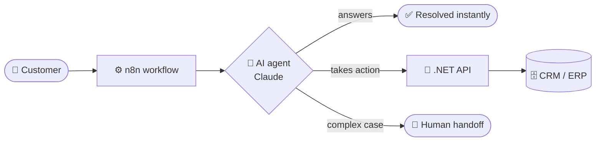

<!-- ===================== HEADER ===================== -->
<p align="center">
  
</p>

<p align="center">
  <a href="https://www.linkedin.com/in/lucaslessapacheco/">
    
  </a>
</p>

<p align="center">
  <a href="https://www.linkedin.com/in/lucaslessapacheco/"></a>
  
</p>

---

## 🤖 About me

I build **AI that talks to customers and automation that does the boring work**.
My focus is **AI agents for customer service** — bots that understand context, resolve real requests,
plug into business systems and hand off to a human when it matters — backed by solid **.NET** APIs,
**React / React Native** front ends and **AWS** infrastructure.

```csharp
public sealed class LucasPacheco : IDeveloper
{
    public string Role => "AI Automation Specialist · Full Stack Developer";

    public string[] Backend  => [".NET", "C#", "Node.js"];
    public string[] Frontend => ["React", "React Native", "TypeScript"];
    public string[] AI       => ["Claude", "Codex", "n8n", "AI Agents"];
    public string   Cloud    => "AWS";

    public string Mission =>
        "Turn customer service and repetitive work into AI-powered automation.";
}
```

## ⚡ What I build

- 💬 **AI customer service agents** — 24/7 support that answers, takes action and escalates smartly
- 🔁 **Workflow automation with n8n** — connecting LLMs, APIs, CRMs and messaging channels
- 🧠 **AI-assisted engineering** — shipping faster with Claude and Codex in the loop
- 🧱 **Full stack products** — .NET / C# back ends with React and React Native apps
- ☁️ **Cloud on AWS** — from prototype to production

### How an AI support flow looks in my hands



---

## 🛠️ Tech stack

<p align="center">
  
</p>

<p align="center">
  
  
  
  
  
  
</p>

---

## 📊 GitHub stats

<p align="center">
  
</p>

<p align="center">
  
  
</p>

<p align="center">
  
</p>

<!-- Snake: generated by .github/workflows/snake.yml (run it once from the Actions tab) -->
<p align="center">
  <picture>
    <source media="(prefers-color-scheme: dark)" srcset="https://raw.githubusercontent.com/dev-lucccaslp/dev-lucccaslp/output/github-snake-dark.svg" />
    <source media="(prefers-color-scheme: light)" srcset="https://raw.githubusercontent.com/dev-lucccaslp/dev-lucccaslp/output/github-snake.svg" />
    
  </picture>
</p>

<!-- ===================== FOOTER ===================== -->
<p align="center">
  
</p>
